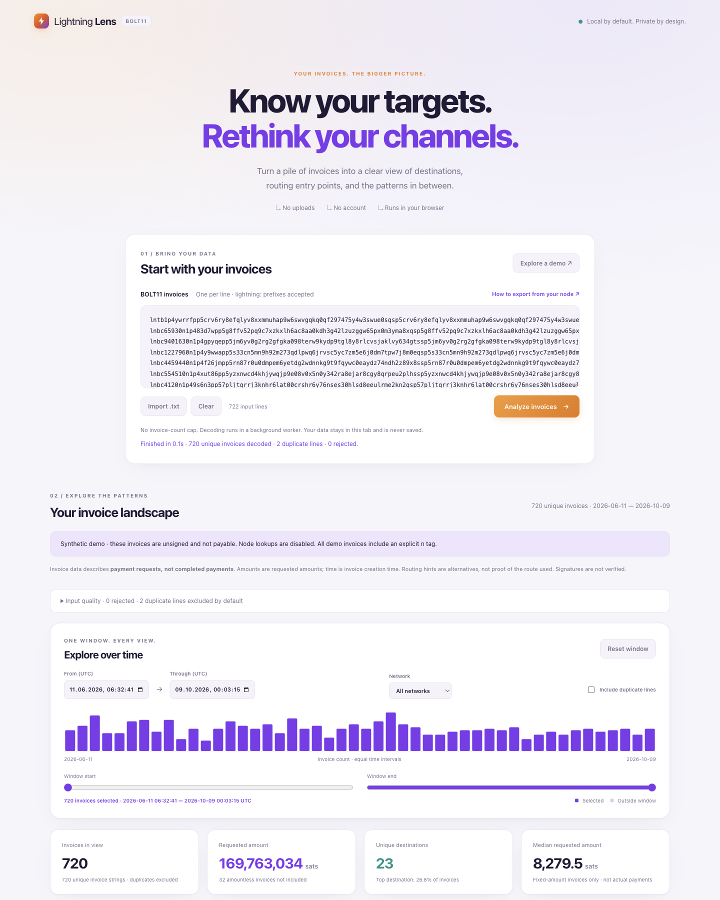

# LN Bolt11 Statistics

### ⚡ Lightning Lens

[](https://github.com/johnzweng/ln-bolt11-statistics/actions/workflows/test.yml)
[](LICENSE)

A private, local-first dashboard for exploring BOLT11 invoices. Paste one invoice per line—or
import a text file—to understand destinations, routing alternatives, amounts, timing, and invoice
anatomy. Decoding happens in your browser, with no account, backend, analytics, remote fonts, or
runtime dependencies.

**[Open the live dashboard](https://lnlense.utxo.at/)** · or [run it locally](#run-locally)

<p align="center">
  <a href="docs/screenshot.png">
    
  </a>
</p>
<p align="center"><sub>Synthetic data · click the preview for the full dashboard</sub></p>

## What it shows

- Real destination node IDs, including private destinations recovered from invoice signatures.
- Effective routing targets from route hints, with Spark identity markers excluded.
- Rankings by invoice count or requested amount, sortable tables, and CSV exports.
- A linked UTC time window and network filter that update every chart and statistic.
- Amount distribution, median, mean, p90, amountless invoices, expiry, CLTV, feature bits,
  descriptions, payment secrets, fallbacks, duplicate hashes, and other invoice signals.
- Progress and cancellation through a Web Worker, so large inputs do not freeze the page.
- Optional, explicit node enrichment through `mempool.space`, with strict request and response
  limits.

Click **Explore a demo** to load deterministic, synthetic invoices. They are unsigned and cannot
be paid.

## Private by design

- Invoice decoding, filtering, aggregation, sorting, and export happen locally.
- Nothing is persisted; reloading the page clears the analysis.
- No external request occurs during analysis.
- Node enrichment is manual and requires confirmation. It shares only selected public keys and
  your IP address with `mempool.space`—never invoices, amounts, descriptions, hashes, or preimages.
- A restrictive Content Security Policy permits only self-hosted application assets and the
  optional node API.

For the threat model, deployment expectations, and reporting process, see
[SECURITY.md](SECURITY.md).

## Read the results carefully

These are **invoice statistics, not payment statistics**. An invoice does not prove that a payment
completed, reveal the route taken, establish fees paid, or describe current channel balances.
Timestamps are invoice creation times and amounts are requested amounts.

Route hints advertise alternatives. When an invoice has several distinct entry nodes, each target
receives one attribution, so routing-target totals are intentionally non-additive. Signatures are
not verified; public-key recovery is used only to identify invoices without an explicit `n` tag.

Amounts remain exact `BigInt` millisatoshis throughout aggregation and export. Exact duplicate
invoice strings are excluded by default; different strings with the same payment hash remain
visible and are flagged.

See [DESIGN.md](DESIGN.md) for the complete semantics and design decisions.

## Run locally

Requires Node.js 22 or newer for the development server and tests:

```sh
git clone https://github.com/johnzweng/ln-bolt11-statistics.git
cd ln-bolt11-statistics
npm run dev
```

Open <http://localhost:4173>. There is no `npm install` or build step. Browsers cannot load the
module-worker setup through `file://`; use HTTP on localhost or HTTPS.

## Export invoices from a node

The dashboard's **How to export from your node** dialog provides copyable recipes for:

- Core Lightning with PostgreSQL; and
- LND through `lncli` and `jq`.

Recipes support successful or failed outcomes and configurable lookback periods. They export
invoice strings—not credentials or preimages. Keep exports private: BOLT11 invoices may contain
sensitive descriptions and routing information.

The exact query semantics and upstream references are documented in
[docs/payment-exports.md](docs/payment-exports.md).

## Deploy

Deploy only [`public/`](public/) to any static HTTPS host, including GitHub Pages. A generic nginx
configuration and Docker example are provided in [`deploy/`](deploy/README.md). The sample avoids
logging query strings or referrers and adds the recommended security headers.

## Project layout

```text
public/                       static application; deploy this directory
├── index.html                accessible dashboard shell and CSP
└── assets/
    ├── app.js                input, worker lifecycle, and filters
    ├── analysis.js           batch decoding and compact records
    ├── statistics.js         pure aggregation and time-series calculations
    ├── worker.js             off-main-thread decoding and progress
    ├── bolt11/               BOLT11, Bech32, secp256k1, SHA-256, and Spark
    └── ui/                   dashboard views, charts, node panels, and export help
deploy/                       generic privacy-preserving nginx example
scripts/                      local server, browser checks, and real-data benchmark
test/                         protocol, statistics, export, network, and hosting tests
DESIGN.md                     requirements, semantics, and decision log
```

The BOLT11, cryptographic, Spark, and lookup code is adapted from
[`lightning-payment-proof`](https://github.com/johnzweng/lightning-payment-proof), also MIT
licensed.

## Tests

```sh
npm run check
npm test
npm run test:real -- /path/to/test_data_pre-images.csv  # optional private fixture
```

`npm run check` checks all JavaScript syntax without executing browser modules. The test suite
uses Node's built-in test runner. Install Bash and jq to run the LND recipe tests (they are skipped
without jq). Coverage includes official BOLT11 vectors, exact millisatoshi aggregation,
duplicates, routing attribution, Spark markers, hostile node aliases,
bounded external responses, export recipes, and hosting safeguards. CI also runs the browser
regression suite in an isolated headless Chrome profile.

For the optional browser regression suite, start the development server:

```sh
npm run dev
```

Then start an isolated Chrome with remote debugging enabled. For example, on macOS:

```sh
open -na "Google Chrome" --args \
  --remote-debugging-port=9333 \
  --user-data-dir=/tmp/lightning-lens-chrome \
  http://127.0.0.1:4173
```

With both running, execute the browser tests in another terminal:

```sh
npm run test:browser
```

Port `4173` serves the application; port `9333` is Chrome's remote-debugging endpoint used by the
tests. See `scripts/browser-smoke.js` for the covered interactions.

## Contributing

Issues and pull requests are welcome. Please keep the project dependency-free, avoid a build step,
preserve local-first behavior, and run `npm run check` and `npm test` before submitting changes.
See [CONTRIBUTING.md](CONTRIBUTING.md) for setup, module responsibilities, testing, and the
behavioral contracts to preserve. Labels in `known-nodes.js` must cite a primary source.

## License

[MIT](LICENSE) © Johannes Zweng
